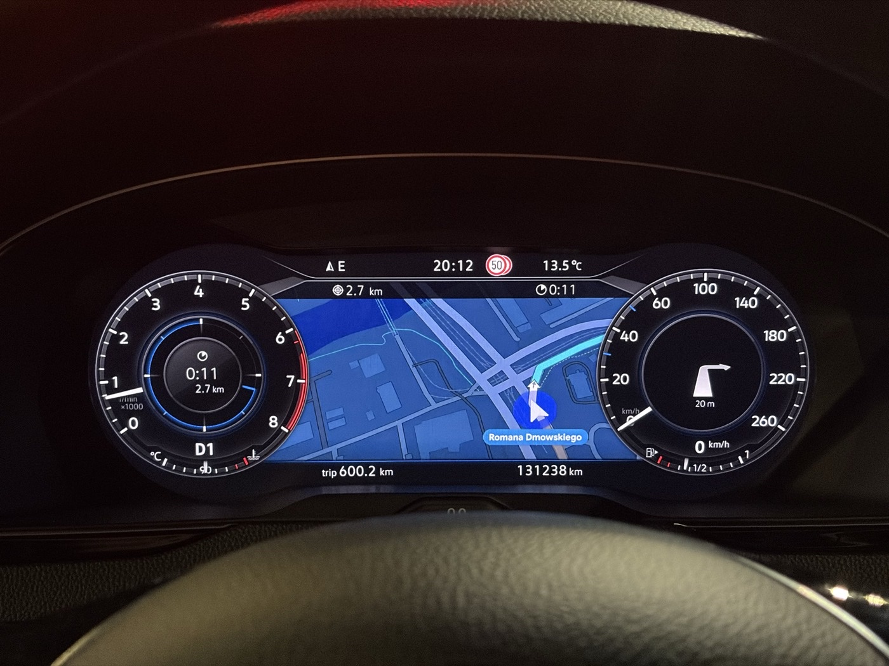
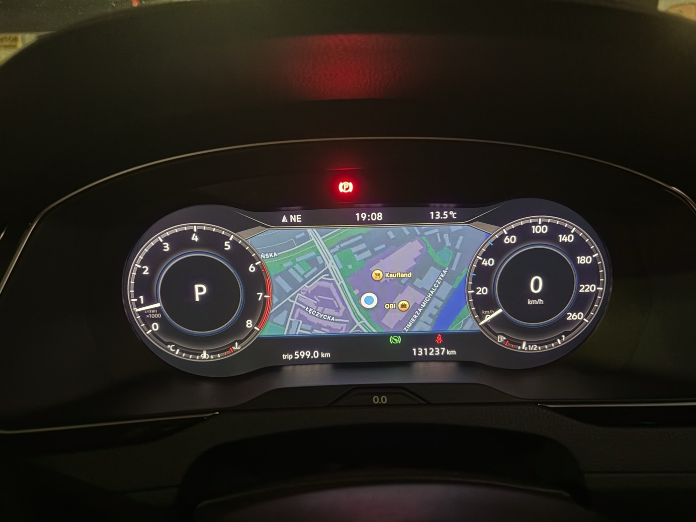

# mhi2-aid-carplay

CarPlay map and native route guidance on the Active Info Display (AID, virtual cockpit) of a **VW Passat B8 (MY2018)**
with a **Discover Pro MHI2** head unit: **MU1161**, train `MHI2_ER_VWG13_P4512`, AID part 791.

[Polska wersja: README.pl.md](README.pl.md)



This repository holds only what is specific to this head unit. It builds on the work of the projects listed under
[Credits](#credits). The general MHI2 CarPlay-on-cluster work lives there.

> **Warning.** This modifies the infotainment of a car. It has been run on exactly one car: MU1161 + AID 791, firmware
> P4512. Every installer step checks file hashes and stops on any mismatch, but you use this at your own risk. Never
> cross-flash firmware to make it fit. Not affiliated with Volkswagen, Harman or Apple.

## What works (tested in the car, October 2026)

| Feature | Status |
|---|---|
| CarPlay map video on the AID (Apple Maps, Google Maps), big and small dial layouts | works |
| NavActiveIgnore: the head unit no longer stops or blocks phone navigation | works |
| Native VW guidance from the iPhone: distance and time to destination on the VW bar and in the left dial | works |
| Native turn arrow and distance to the manoeuvre (appears once the car moves) | works |
| Map zoom with the steering-wheel arrows | works |
| CarPlay track title and artist on the AID | works |
| Day/night switching of the cluster map | works |
| Speed limit from the phone (`showSpeedLimit=yes`) | shows nothing on this unit |



More photos and an interactive model of the AID frame (where the video lands on the panel for each variant):
[`docs/aid-frame-map.html`](docs/aid-frame-map.html), photos in [`docs/img/`](docs/img/).

## Components

| Directory | What it builds | Lands on the unit |
|---|---|---|
| [`patches/mu1161/`](patches/mu1161/) | `core.so` variants of the CarPlay cluster stream (safe area, URL, frame rate, key frames, physical size) from one hash-pinned base | `core.so` |
| [`navactiveignore/`](navactiveignore/) | NavActiveIgnore built from the unit's own HMI classes | Java (HMI) |
| [`rg/`](rg/) | Native route guidance: port of tomasz-twardzicki's MU1427 solution to MU1161 (iAP2 RouteGuidance → BAP) | Java, iAP2 driver, `iap2.cfg`, reader |
| [`nowplaying/`](nowplaying/) | CarPlay track title and artist on the cluster | Java (HMI) |
| [`hmiextras/`](hmiextras/) | Steering-wheel zoom and day/night resend for the cluster map | Java (HMI) |
| [`installer/`](installer/) | SD-card installer run from the M.I.B. GEM menu, the rescue card, host tests | nothing by itself |
| [`buildtools/`](buildtools/) | Host checks: try/catch guard around every hook call, J9 CDC API check | nothing |
| [`scripts/`](scripts/) | Read-only firmware readers (QNX6, IFS, LZOZ, JXE → JAR), SD-card tester | nothing |
| [`firmware/`](firmware/) | Hashes and notes for the official K4525 update (the only allowed firmware) | nothing |

### Map layout variants (GEM → `pmcp_zmien_wariant`)

The stream is 800×480 and lies 1:1 on the AID panel. Safe area values are x / y / width / height.

| Variant | URL | Safe area | Notes |
|---|---|---|---|
| `map-clean` | `maps:/car/instrumentcluster/map` | 200 / 108 / 400 / 296 | map only, VW shows guidance natively |
| `card-clean` | `maps:/car/instrumentcluster` | 200 / 108 / 400 / 296 | with the iPhone's manoeuvre card |
| `url-map-hybrid` | `…/map?showSpeedLimit=yes` | 200 / 108 / 400 / 296 | speed-limit parameter (no effect seen) |
| `map-clean-l40` | `maps:/car/instrumentcluster/map` | 160 / 108 / 400 / 296 | 40 columns to the left |
| `map-square` (default) | `maps:/car/instrumentcluster/map` | 240 / 60 / 320 / 340 | mathsls's MU1161 layout, closer to square; best after a longer drive |

All variants declare a physical size of 240×144 mm. Switching a variant swaps one file (`core.so`) and needs a restart.

## Download and install

**[Download the latest release](https://github.com/chrzanowy/mhi2-aid-carplay/releases/latest)**: the file
`mhi2-aid-carplay-cards-<build id>.zip`. It holds both SD cards ready to use. No programs to install, Windows or Mac.

1. Unpack the zip and open `README-FIRST.txt`. It walks you through everything in plain English.
2. Double-click `Copy-to-SD-Windows.bat` (Windows) or `Copy-to-SD-macOS.command` (Mac). It copies a card onto an
   **empty** FAT32 SD card, checks every file and ejects the card. It never formats a card or deletes anything.
   Make card 2 (rescue) first, then card 1 (install).
3. In the car: follow part 2 of `README-FIRST.txt` (full guide with details: [in-car guide](docs/en/09-in-car-guide.md)).
   The green menu's main screen has the simple path: check, install the map, install all features (one trial start),
   confirm. After the rescue card test, the copy helper's option 3 checks its result and unlocks the features.

Before you start you need [M.I.B. installed on the unit and a backup](docs/en/01-mib-install-backup.md). The installer
on the card checks every file of your head unit first. On any other firmware it stops and changes nothing.

Check the download against `SHA256SUMS.txt` from the same release if you want to be sure it is complete.

## Build the cards yourself (advanced)

Instead of the ready-made cards, you can build them from your own unit's M.I.B. backup (macOS; Linux works for
building). The result is byte-identical to the release.

```sh
mkdir ~/mhi2-workspace && cd ~/mhi2-workspace
git clone https://github.com/chrzanowy/mhi2-aid-carplay.git
cd mhi2-aid-carplay
./install.sh                # or double-click Install-macOS.command in Finder
```

`install.sh` goes through 11 numbered steps. Each one says what it does and why, and shows every command it runs:
it checks your computer and your backup (train `MHI2_ER_VWG13_P4512` / MU1161, every file by SHA-256), downloads the
pinned sources, builds and tests everything (including power loss at every write step), builds the two card folders
and can write them to SD cards. On any mismatch it stops and says what to do. The full log is in
`logs/install-<date>.log`. `python3 -I release/make_release.py build dist` then packs the release zip.

## Installer

The installer runs from the GEM (engineering) menu of [M.I.B.](https://github.com/Mr-MIBonk/M.I.B._More-Incredible-Bash)
on an SD card. Design rules:

- **Fail-closed.** Every file on the unit and on the card is checked by exact hash and size before anything is
  written. Unknown state means no change.
- Files are staged, verified and swapped in, and the stock files are backed up first. "Restore factory files" is
  always available.
- **Java packages use a trial boot.** After "Wlacz" (enable) and a restart, the change must be confirmed ("Potwierdz")
  in the same boot. Otherwise the next boot is stock again.
- A separate **rescue card** (`installer/build_rescue.py`) autostarts in update mode and restores the stock HMI
  without needing GEM.
- Host tests (`installer/test/run_tests.sh`, `fault_inject.sh`) run the installer against a copy of the unit's file
  tree under `mksh` and `ksh`. They include power loss at every write step.

Step-by-step guide for the car: [`docs/en/09-in-car-guide.md`](docs/en/09-in-car-guide.md).
Installer design: [`docs/en/07-installer.md`](docs/en/07-installer.md).

## Building

This repository (the source) ships **no binaries** and nothing from Volkswagen firmware. Every build reads its inputs from a
workspace next to this repository and checks each input by SHA-256:

```
workspace/
  mhi2-aid-carplay/        this repository
  upstream/                clones of the projects below, at the pinned commits
  backup/MU1161/           M.I.B. backup of your unit (or set PMCP_BACKUP)
  archives/                M.I.B. 3.6.0 GEM menu, converted lsd.jar of your unit
```

| Input | Source | Pinned |
|---|---|---|
| base `core.so` (MU1102/791 profile, sha256 `00b48a8f…`) | omonob payload as shipped in M.I.B. | commit `3a2526a3` |
| route guidance, patch sites | tomasz-twardzicki/MHI2-Carplay-Maps | commit `024dd159` |
| MU1161/791 reference payload | mathsls/MHI2-Carplay-Maps | commit `cdd576b0` |
| JXE → JAR converter | luka-dev/jxe2jar | commit `9eeb45bb` |
| GEM menu (`Launcher-sda0.esd`) | M.I.B. 3.6.0 release zip | sha256 `4bfc6e72…` |
| HMI classes, iAP2 driver | your own unit (M.I.B. backup) | sha256 per file |
| host tools | ASM 9.7 (Java builds), pyelftools 0.31 in `upstream/tools/venv-elftools` (`rg/`), gawk 3.1.5 in `upstream/tools/` (tests) | ASM jars by sha256 |

Build order: `navactiveignore/`, `nowplaying/`, `hmiextras/`, `rg/` (`build.sh` in each; needs JDK 11+ and ASM 9.7 in
`$ASM_DIR`), then `patches/mu1161/build_core.py`, `installer/build_sd.py`, `installer/build_card_install.py` and
`installer/build_rescue.py`. Run Python with `python3 -I`. If any input differs from the pinned hash, the build stops.

## Documentation

English in [`docs/en/`](docs/en/), Polish in [`docs/pl/`](docs/pl/):

| Topic | English | Polish |
|---|---|---|
| Installing M.I.B. and backing up the unit (do this first) | [01-mib-install-backup](docs/en/01-mib-install-backup.md) | [01-mib-instalacja-backup](docs/pl/01-mib-instalacja-backup.md) |
| HMI analysis: map stream, AID size detection, CarPlay and guidance classes | [04-lsd-jxe-decompilation](docs/en/04-lsd-jxe-decompilation.md) | [04-lsd-jxe-dekompilacja](docs/pl/04-lsd-jxe-dekompilacja.md) |
| Installer design | [07-installer](docs/en/07-installer.md) | [07-instalator](docs/pl/07-instalator.md) |
| Step-by-step guide in the car | [09-in-car-guide](docs/en/09-in-car-guide.md) | [09-tutorial-w-aucie](docs/pl/09-tutorial-w-aucie.md) |
| Interactive AID frame model | [aid-frame-map.html](docs/aid-frame-map.html) | [aid-frame-map.pl.html](docs/aid-frame-map.pl.html) |

The READMEs inside the component directories are in Polish.

## Credits

This project would not exist without:

- **[omonob/MHI2-Carplay-Maps](https://github.com/omonob/MHI2-Carplay-Maps)**: the original CarPlay map on the MHI2
  virtual cockpit. Its `core.so` (MU1102/791 profile) is the base that every variant here patches.
- **[Mr-MIBonk/M.I.B.](https://github.com/Mr-MIBonk/M.I.B._More-Incredible-Bash)**: the GEM toolbox the installer runs
  from, the unit backup, and the distribution of the omonob payload.
- **[tomasz-twardzicki/MHI2-Carplay-Maps](https://github.com/tomasz-twardzicki/MHI2-Carplay-Maps)**: the `core.so` patch
  sites (frame rate, key frames, URL, safe area), NavActiveIgnore classes, and the native route guidance solution
  (driver patch chain, HMI bridge, RGI reader) that `rg/` ports to MU1161.
- **[mathsls/MHI2-Carplay-Maps](https://github.com/mathsls/MHI2-Carplay-Maps)**: the first MU1161 + AID 791 build. The
  physical-size sites and the layout used by `map-square` come from it.
- **[ZzYunOvO/MHI2-Carplay-Maps](https://github.com/ZzYunOvO/MHI2-Carplay-Maps)**: the toolbox that the mathsls and
  tomasz-twardzicki forks build on.
- **diasdio** and **ramasauskas**: key-frame and safe-area height fixes, the AUSAFE queue fix in the MOST bridge.
- **harman-f**: cluster URL query parameters (`showETA`, `maneuverLayout`, `showSpeedLimit`).
- **[luka-dev](https://github.com/luka-dev/jxe2jar)**: jxe2jar and the RGI decoder.
- **maxim-smirnov**: documentation of the LZOZ container format.
- **MacsInSpace**: the "Forget this car" tip when the cluster gets no picture.
- The **MQB Toolbox** community: the original NavActiveIgnore idea.

Files that adapt code from these projects name their source and commit in the header or README.

## License

GPL-3.0-or-later, see [LICENSE](LICENSE). It is the same license as the omonob, tomasz-twardzicki and mathsls projects
this builds on.
