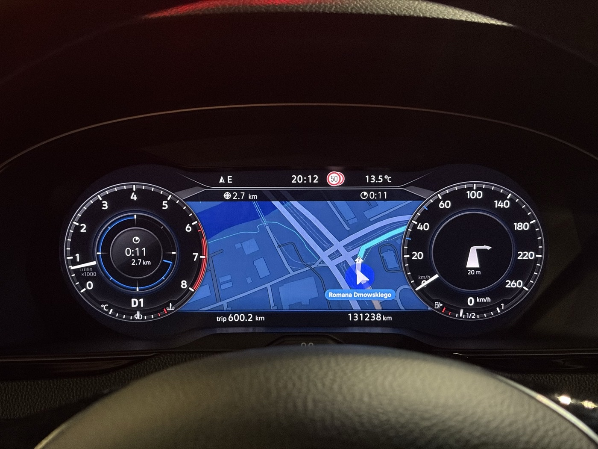
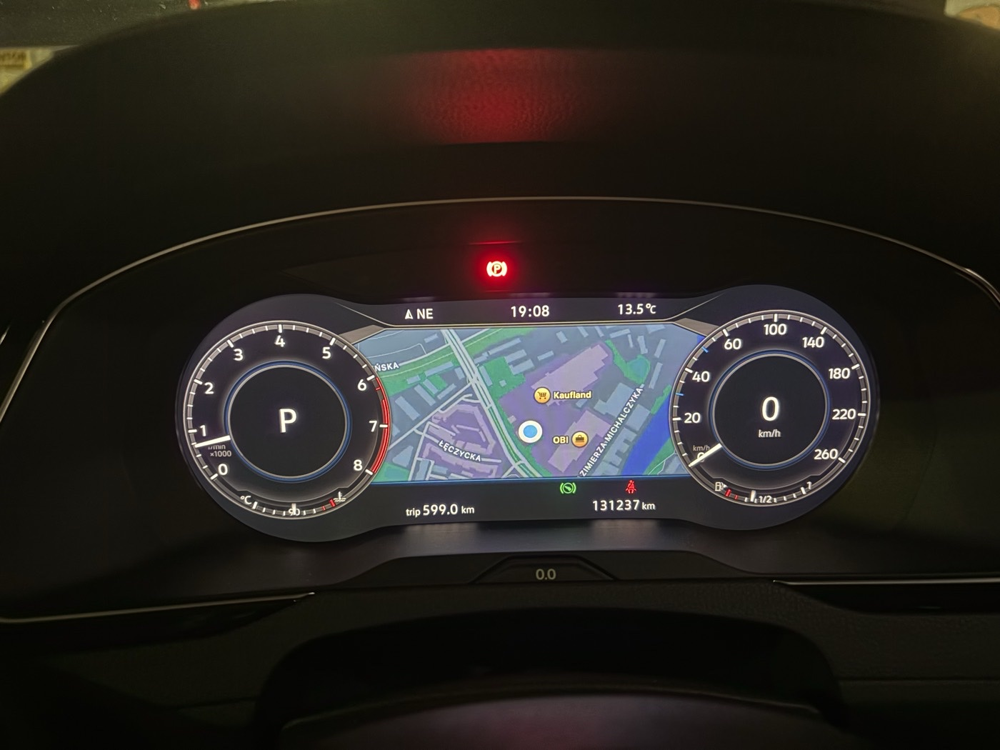

# mhi2-aid-carplay

Mapa CarPlay i natywne prowadzenie na wirtualnym kokpicie (AID) **VW Passata B8 (MY2018)** z radiem **Discover Pro MHI2**:
**MU1161**, train `MHI2_ER_VWG13_P4512`, AID 791.

[English version: README.md](README.md)



W repo jest tylko to, co dotyczy tego radia. Całość opiera się na pracy projektów wymienionych w sekcji
[Podziękowania](#podziękowania). Tam jest ogólne rozwiązanie mapy CarPlay na liczniku MHI2.

> **Uwaga.** To modyfikuje system multimedialny auta. Uruchomione w dokładnie jednym aucie: MU1161 + AID 791, firmware
> P4512. Każdy krok instalatora sprawdza hashe plików i zatrzymuje się przy każdej niezgodności, ale używasz na własne
> ryzyko. Nigdy nie wgrywaj firmware'u z innej gałęzi (cross-flash), żeby coś pasowało. Projekt niezwiązany z Volkswagenem,
> Harmanem ani Apple.

## Co działa (sprawdzone w aucie, październik i listopad 2026)

| Funkcja | Stan |
|---|---|
| Mapa CarPlay na AID (Mapy Apple, Google Maps), duże i małe zegary | działa |
| NavActiveIgnore: radio nie zatrzymuje i nie blokuje nawigacji z telefonu | działa |
| Natywne prowadzenie VW z iPhone'a: dystans i czas do celu na pasku VW i w lewej tarczy | działa |
| Natywna strzałka manewru i dystans do manewru (pojawia się po ruszeniu) | działa |
| Strzałka na starcie trasy i przy skrętach na rondzie (zastępcza tam, gdzie ścisłe mapowanie nie daje żadnej) | działa |
| Pasek odległości przed manewrem (odliczanie VW) i nazwa bieżącej ulicy | działa |
| Natywne pasy ruchu VW, także pasy do zawracania (gdy aplikacja w telefonie wysyła pasy) | działa |
| Prowadzenie przetrwa zawieszony odczyt sterownika iAP2 (czytnik restartuje swój proces roboczy zamiast się kończyć) | w aucie od 2026-11-03; odzyskiwanie sprawdzone na komputerze |
| Przybliżanie mapy strzałkami na kierownicy | działa |
| Tytuł i wykonawca utworu z CarPlay na AID | działa |
| Przełączanie dzień/noc mapy na liczniku | działa |
| Ograniczenie prędkości z telefonu (`showSpeedLimit=yes`) | na tym radiu nic nie pokazuje |
| Opcjonalnie (v1.4.1, paczka `sl`; przyciski trybu poprawione w v1.4.2 od amjad-alarori): limit z map samego auta VW przed nazwą ulicy albo próbnie w CurrentPositionInfo | 50 → 70 km/h potwierdzone w e-Golfie (AID 795A); na AID 791 jeszcze nie sprawdzone. [Opis po angielsku](docs/en/16-native-speed-limits.md) |

Prowadzenie iAP2 nie przenosi liczbowego ograniczenia prędkości (badania
[maxim-smirnov/mhi2-carplay-cluster](https://github.com/maxim-smirnov/mhi2-carplay-cluster) na iOS 26.6/27);
`showSpeedLimit=yes` tylko prosi telefon o narysowanie znaku w obrazie, a na tym radiu znaku nie widać.



v1.4 w aucie (2026-11-04), Apple Maps z natywnym prowadzeniem VW: nazwa ulicy na górnym pasku i w prawym zegarze,
strzałka skrętu z paskiem VW odliczającym do manewru, czas i dystans do celu oraz pasy ruchu VW (drugie zdjęcie). Znak
ograniczenia prędkości u góry pochodzi z samego auta (rozpoznawanie znaków i dane nawigacji VW), nie z telefonu.

| | |
|---|---|
|  |  |

Więcej zdjęć i interaktywny model ramki AID (gdzie obraz trafia na panel w każdym wariancie):
[`docs/aid-frame-map.pl.html`](docs/aid-frame-map.pl.html), zdjęcia w [`docs/img/`](docs/img/).

## Składniki

| Katalog | Co buduje | Trafia do radia |
|---|---|---|
| [`patches/mu1161/`](patches/mu1161/) | warianty `core.so` strumienia CarPlay na licznik (safe area, URL, liczba klatek, klatki kluczowe, rozmiar fizyczny) z jednej przypiętej hashem bazy | `core.so` |
| [`navactiveignore/`](navactiveignore/README.pl.md) | NavActiveIgnore z własnych klas HMI radia | Java (HMI) |
| [`rg/`](rg/README.pl.md) | natywne prowadzenie (jedna paczka `rg`): port rozwiązania tomasz-twardzicki z MU1427 na MU1161 (iAP2 RouteGuidance → BAP) z jego pasami, paskiem odległości i nazwą ulicy, nasze pasy do zawracania i zastępcze strzałki, nasza bramka logu iAP2 i czytnik | Java, sterownik iAP2, `iap2.cfg`, czytnik |
| [`nowplaying/`](nowplaying/README.pl.md) | tytuł i wykonawca utworu CarPlay na liczniku | Java (HMI) |
| [`hmiextras/`](hmiextras/README.pl.md) | zoom z kierownicy i ponowne wysłanie dzień/noc do mapy na liczniku | Java (HMI) |
| [`speedlimit/`](speedlimit/) | opcjonalny limit prędkości z map VW w tekście nawigacji licznika | Java (HMI), zapisywane ustawienie. [Opis po angielsku](docs/en/16-native-speed-limits.md) |
| [`installer/`](installer/) | instalator na kartę SD uruchamiany z menu GEM w M.I.B., karta ratunkowa, testy na Macu | nic sam z siebie |
| [`buildtools/`](buildtools/) | kontrole przy budowaniu: osłona try/catch każdego wywołania haka, zgodność z API J9 CDC | nic |
| [`scripts/`](scripts/) | czytniki obrazów firmware'u tylko do odczytu (QNX6, IFS, LZOZ, JXE → JAR), tester kart SD | nic |
| [`firmware/`](firmware/) | hashe i notatki oficjalnej aktualizacji K4525 (jedyny dozwolony firmware) | nic |

### Warianty układu mapy (GEM → `pmcp_advanced` → `pmcp_switch_layout`)

Strumień ma 800×480 i leży 1:1 na panelu AID. Safe area: x / y / szerokość / wysokość.

| Wariant | URL | Safe area | Uwagi |
|---|---|---|---|
| `map-clean` | `maps:/car/instrumentcluster/map` | 200 / 108 / 400 / 296 | sama mapa, prowadzenie pokazuje VW natywnie |
| `card-clean` | `maps:/car/instrumentcluster` | 200 / 108 / 400 / 296 | z kartą manewru iPhone'a |
| `url-map-hybrid` | `…/map?showSpeedLimit=yes` | 200 / 108 / 400 / 296 | parametr ograniczenia prędkości (bez efektu) |
| `map-clean-l40` | `maps:/car/instrumentcluster/map` | 160 / 108 / 400 / 296 | 40 kolumn w lewo |
| `map-square` | `maps:/car/instrumentcluster/map` | 240 / 60 / 320 / 340 | układ mathsls dla MU1161, bliżej kwadratu; najlepszy po dłuższej jeździe; 30 kl./s |
| `map-square-fps40` (domyślny) | `maps:/car/instrumentcluster/map` | 240 / 60 / 320 / 340 | `map-square` przy 40 kl./s (jak u mathsls); w jeździe testowej bez większego opóźnienia niż 30 kl./s |

Wszystkie warianty deklarują rozmiar fizyczny 240×144 mm. Zmiana wariantu podmienia jeden plik (`core.so`) i wymaga restartu.

## Pobieranie i instalacja

**[Pobierz najnowsze wydanie](https://github.com/chrzanowy/mhi2-aid-carplay/releases/latest)**: plik
`mhi2-aid-carplay-cards-<build id>.zip` z gotowymi obiema kartami SD. Nic nie trzeba instalować, Windows albo Mac.

1. Rozpakuj zip i otwórz `README-FIRST.txt` (po angielsku, krok po kroku).
2. Dwuklik na `Copy-to-SD-Windows.bat` (Windows) albo `Copy-to-SD-macOS.command` (Mac): kopiuje kartę na **pustą**
   kartę SD FAT32, sprawdza każdy plik i wysuwa kartę. Niczego nie formatuje ani nie usuwa. Zrób kartę 1
   (instalacyjną) i kartę 2 (ratunkową, na awarię).
3. W aucie, jedna wizyta, tylko karta 1 (część 2 w `README-FIRST.txt`, szczegóły: [tutorial w aucie](docs/pl/09-tutorial-w-aucie.md)):
   **1. Check → 2. Install map → restart → mapa OK? → 3. Install all features → restart (start próbny) → test →
   4. Confirm → restart.** Od tej chwili tak już zostaje.
   Karta 2 jest tylko na awarię po potwierdzeniu. Po użyciu sama się rozbraja; opcja 3 pomocnika kopiowania ją uzbraja.

**Aktualizacja z v1.0–v1.3:** karta 1 z tego wydania, „1. Check”, potem **3. Install all features or update** → restart
(start próbny) → test → **4. Confirm**. Przycisk 3 zastępuje wcześniejszy sterownik, czytnik i paczki Java (`rglu` → `rg`)
plikami z tej karty. Zrób też nową kartę 2: karty ratunkowe sprzed v1.4 nie przywracają sterownika iAP2 z v1.4.
Eksperymentalne Android Auto z gałęzi `experimental` ta karta też zdejmuje: przycisk 3 (i „Remove everything”) najpierw
przywraca fabryczny `gal` z kopii o sprawdzonym hashu; w menu zaawansowanym jest osobny przycisk „Remove experimental
Android Auto”.

Wcześniej potrzebny jest [M.I.B. w radiu i backup](docs/pl/01-mib-instalacja-backup.md). Instalator na karcie najpierw
sprawdza każdy plik radia; przy innym firmware zatrzymuje się i niczego nie zmienia.

Samodzielne zbudowanie kart z własnego backupu (zaawansowane, macOS): `./install.sh`, szczegóły w
[README.md](README.md#build-the-cards-yourself-advanced).

## Instalator

Instalator uruchamia się z menu GEM (inżynierskiego) w [M.I.B.](https://github.com/Mr-MIBonk/M.I.B._More-Incredible-Bash)
z karty SD. Zasady:

- **Fail-closed.** Każdy plik w radiu i na karcie jest sprawdzany dokładnym hashem i rozmiarem, zanim cokolwiek zostanie
  zapisane. Nieznany stan oznacza brak zmian.
- Pliki są kopiowane do katalogu przejściowego, sprawdzane i dopiero wtedy podmieniane. Wcześniej powstaje kopia plików
  fabrycznych. „Przywróć pliki fabryczne” działa zawsze.
- **Paczki Java mają start próbny.** Po „3. Install all features” (albo „On ...” dla jednej paczki) i restarcie zmianę
  trzeba potwierdzić („4. Confirm”) w tym samym starcie.
  Inaczej następny start jest znowu fabryczny.
- Osobna **karta ratunkowa** (`installer/build_rescue.py`) startuje sama w trybie aktualizacji i przywraca fabryczne HMI
  bez potrzeby wchodzenia do GEM.
- Testy na Macu (`installer/test/run_tests.sh`, `fault_inject.sh`) uruchamiają instalator na kopii drzewa plików radia,
  w powłokach `mksh` i `ksh`. Symulują też zanik zasilania na każdym kroku zapisu.

Instrukcja krok po kroku w aucie: [`docs/pl/09-tutorial-w-aucie.md`](docs/pl/09-tutorial-w-aucie.md).
Projekt instalatora: [`docs/pl/07-instalator.md`](docs/pl/07-instalator.md).

## Budowanie

Repo (źródła) **nie zawiera binarek** ani niczego z firmware'u Volkswagena. Każdy build czyta wejścia z katalogu roboczego obok
repo i sprawdza każde wejście hashem SHA-256:

```
workspace/
  mhi2-aid-carplay/        to repo
  upstream/                klony projektów niżej, na przypiętych commitach
  backup/MU1161/           backup M.I.B. Twojego radia (albo zmienna PMCP_BACKUP)
  archives/                menu GEM z M.I.B. 3.6.0, przekonwertowany lsd.jar Twojego radia
```

| Wejście | Źródło | Przypięte |
|---|---|---|
| bazowy `core.so` (profil MU1102/791, sha256 `00b48a8f…`) | paczka omonob w M.I.B. | commit `3a2526a3` |
| natywne prowadzenie, miejsca łatek | tomasz-twardzicki/MHI2-Carplay-Maps | commit `024dd159` (MU1427), `7925a83` (pasy), `1d69473` (pasek odległości, ulica, odzyskiwanie) |
| tablica manewrów dla zastępczych strzałek | harman-f/mhi2_altscreen_carplay (`MibrRgiManeuvers.java`) | commit `c01bbdc` |
| paczka referencyjna MU1161/791 | mathsls/MHI2-Carplay-Maps | commit `cdd576b0` |
| konwerter JXE → JAR | luka-dev/jxe2jar | commit `9eeb45bb` |
| menu GEM (`Launcher-sda0.esd`) | zip M.I.B. 3.6.0 | sha256 `4bfc6e72…` |
| klasy HMI, sterownik iAP2 | Twoje radio (backup M.I.B.) | sha256 każdego pliku |
| narzędzia | ASM 9.7 (buildy Java), pyelftools 0.31 w `upstream/tools/venv-elftools` (`rg/`), gawk 3.1.5 w `upstream/tools/` (testy) | jary ASM po sha256 |

Kolejność: `navactiveignore/`, `nowplaying/`, `hmiextras/`, `rg/` (w każdym `build.sh`; potrzebny JDK 11+ i ASM 9.7
w `$ASM_DIR`), potem `patches/mu1161/build_core.py`, `installer/build_sd.py`, `installer/build_card_install.py`
i `installer/build_rescue.py`. Pythona uruchamiaj z `python3 -I`. Gdy którekolwiek wejście ma inny hash, build się zatrzymuje.

## Dokumentacja

Po polsku w [`docs/pl/`](docs/pl/), po angielsku w [`docs/en/`](docs/en/):

| Temat | Polski | English |
|---|---|---|
| Instalacja M.I.B. i backup radia (zrób najpierw) | [01-mib-instalacja-backup](docs/pl/01-mib-instalacja-backup.md) | [01-mib-install-backup](docs/en/01-mib-install-backup.md) |
| Analiza HMI: strumień mapy, wykrywanie rozmiaru AID, klasy CarPlay i prowadzenia | [04-lsd-jxe-dekompilacja](docs/pl/04-lsd-jxe-dekompilacja.md) | [04-lsd-jxe-decompilation](docs/en/04-lsd-jxe-decompilation.md) |
| Projekt instalatora | [07-instalator](docs/pl/07-instalator.md) | [07-installer](docs/en/07-installer.md) |
| Audyt: szybki start mapy na AID (próby, porażka, dlaczego AID wymagał uśpienia auta) | [14-audyt-szybki-start](docs/pl/14-audyt-szybki-start.md) | [14-fast-start-audit](docs/en/14-fast-start-audit.md) |
| Instrukcja krok po kroku w aucie | [09-tutorial-w-aucie](docs/pl/09-tutorial-w-aucie.md) | [09-in-car-guide](docs/en/09-in-car-guide.md) |
| Interaktywny model ramki AID | [aid-frame-map.pl.html](docs/aid-frame-map.pl.html) | [aid-frame-map.html](docs/aid-frame-map.html) |

Katalogi składników mają `README.md` po angielsku i `README.pl.md` po polsku.

## Eksperymentalnie: Android Auto na AID (w toku)

Jeszcze w żadnym wydaniu. Pracujemy nad tym samym dla Android Auto: obraz Google Maps na AID i natywne strzałki VW
z manewrów Google Maps, przez własną drogę MOST radia (bez dodatkowego adaptera). Stan na 2026-11-04, sprawdzony w aucie:

Jak to działa:
- fabryczny odbiornik Android Auto `gal` uruchamia mały wrapper z hookiem (na bazie
  [mib-cluster-map](https://github.com/MacsInSpace/mib-cluster-map) MacsInSpace, bez ścieżek do karty SD);
- hook proponuje telefonowi drugi ekran „cluster” 800×480 i oddaje jego strumień H.264 naszemu feederowi;
- feeder przejmuje kanał wideo MOST i zapisuje klatki do tego samego ringu i `altscreen-most-bridge`, z których korzysta
  CarPlay;
- każdy nowy zestaw Android Auto rusza raz jako próba i zostaje dopiero po potwierdzeniu w GEM, jak paczki Java.

Co działa:
- obraz Google Maps na AID (26 minut jazdy bez problemów w trybie „AA 2”);
- przełączenie z CarPlay na Android Auto bez restartu (feeder używa teraz ringu wideo CarPlay w miejscu; `dio_manager`
  trzyma ten ring zmapowany, więc jego usuwanie zapełniało `/ramdisk`);
- natywne strzałki VW z dystansem z manewrów Google Maps („gamma”). Hook tłumaczy komunikaty nawigacji Android Auto na
  ten sam format skrzynki, który zapisuje czytnik CarPlay, a ten sam kod Java je pokazuje. W jeździe testowej rozpoznał
  94 z 94 manewrów.

Co jeszcze nie działa:
- **gubiony obraz:** w mniej więcej połowie połączeń obraz startuje ciemny, z artefaktami, a AID potrafi też zgubić obraz
  w trakcie jazdy (ekran ładowania). Ta sama przyczyna: telefon wysyła tylko jedną klatkę kluczową na sesję.
  - Bez skutku próbowaliśmy: czekania 5 albo 10 s po przejęciu kanału MOST oraz przytrzymania i powtarzania tej klatki.
  - Dalej: feeder dawkuje klatki do mostka (ok. 2 Mbit/s) i zapisuje przerwy w strumieniu (zbudowane i sprawdzone na
    komputerze, jeszcze nie w aucie); inny `idr_pic_id` w powtórkach zostaje pomysłem. Własnego oprogramowania wideo radia
    nie ruszamy.
  - Obejście: ponownie podłączyć telefon.
- brak strzałki VW na samym starcie trasy z Android Auto (krok „depart” nie jest jeszcze mapowany).

Co ustaliliśmy:
- ponowne wysłanie konfiguracji wideo do telefonu zrywa połączenie Android Auto po ok. 9 s;
- cykl fokusu w radiu psuje sesję telefonu (spada do ok. 3 kl./s i po ok. dwóch minutach zrywa połączenie);
- pełne komunikaty nawigacji Google Maps wymagają protokołu Android Auto 1.7;
- dystans i czas do celu zostawiamy obrazowi Android Auto, który już je pokazuje.

Karta z wydania v1.4 zawsze potrafi zdjąć to eksperymentalne Android Auto („Remove experimental Android Auto”; przycisk 3
i „Remove everything” robią to najpierw): przywraca fabryczny `gal` tylko z kopii o fabrycznym hashu.

## Podziękowania

Ten projekt nie powstałby bez:

- **[omonob/MHI2-Carplay-Maps](https://github.com/omonob/MHI2-Carplay-Maps)**: pierwotne rozwiązanie mapy CarPlay na
  wirtualnym kokpicie MHI2. Jego `core.so` (profil MU1102/791) jest bazą, którą łata każdy wariant tutaj.
- **[Mr-MIBonk/M.I.B.](https://github.com/Mr-MIBonk/M.I.B._More-Incredible-Bash)**: narzędzia GEM, z których startuje
  instalator, backup radia i dystrybucja paczki omonob.
- **[tomasz-twardzicki/MHI2-Carplay-Maps](https://github.com/tomasz-twardzicki/MHI2-Carplay-Maps)**: miejsca łatek
  `core.so` (liczba klatek, klatki kluczowe, URL, safe area), klasy NavActiveIgnore i rozwiązanie natywnego prowadzenia
  (łańcuch łatek sterownika, most HMI, czytnik RGI), które `rg/` przenosi na MU1161: MU1427 v1.2.0 (strzałki, dystans,
  ETA, ścisłe mapowanie manewrów `LiveModel.map`), pasy ruchu z MU1367 v1.4.0 oraz pasek odległości, nazwa ulicy
  i odzyskiwanie strumienia z MU1367 v1.4.3 oraz podtrzymanie trasy Apple Maps z MU1367 v1.4.4 (nasze v1.4.3).
- **[mathsls/MHI2-Carplay-Maps](https://github.com/mathsls/MHI2-Carplay-Maps)**: pierwszy build dla MU1161 + AID 791.
  Z niego pochodzą miejsca rozmiaru fizycznego i układ wariantu `map-square`.
- **[ZzYunOvO/MHI2-Carplay-Maps](https://github.com/ZzYunOvO/MHI2-Carplay-Maps)**: zestaw narzędzi, na którym opierają
  się forki mathsls i tomasz-twardzicki.
- **diasdio** i **ramasauskas**: poprawki klatek kluczowych i wysokości safe area, poprawka kolejki AUSAFE w moście MOST.
- **harman-f**: parametry URL licznika (`showETA`, `maneuverLayout`, `showSpeedLimit`) oraz tablica manewrów iAP2 → VW BAP
  z [mhi2_altscreen_carplay](https://github.com/harman-f/mhi2_altscreen_carplay) (`MibrRgiManeuvers.java`, commit
  `c01bbdc`, GPL-3.0), z której korzystają zastępcze strzałki w `rg/`.
- **[luka-dev](https://github.com/luka-dev/jxe2jar)**: jxe2jar, dekoder RGI i nazwy typów manewrów iAP2.
- **[amjad-alarori](https://github.com/amjad-alarori)**: opcjonalna paczka limitu prędkości z map VW `speedlimit/` (PR #3):
  hak `DSITrafficRegulation`, filtr limitu oraz jego akcje instalatora i testy; poprawka przycisków trybu w radiu
  (PR #5, v1.4.2).
- **maxim-smirnov**: opis formatu kontenera LZOZ oraz badania pokazujące, że prowadzenie iAP2 nie przenosi ograniczenia
  prędkości ([mhi2-carplay-cluster](https://github.com/maxim-smirnov/mhi2-carplay-cluster)).
- **MacsInSpace**: wskazówka „Zapomnij to auto”, gdy licznik nie dostaje obrazu.
- Społeczność **MQB Toolbox**: pierwotny pomysł NavActiveIgnore.

Pliki, które adaptują kod z tych projektów, podają źródło i commit w nagłówku albo w README.

## Licencja

GPL-3.0-or-later, zobacz [LICENSE](LICENSE). To ta sama licencja co w projektach omonob, tomasz-twardzicki i mathsls,
na których to się opiera.
