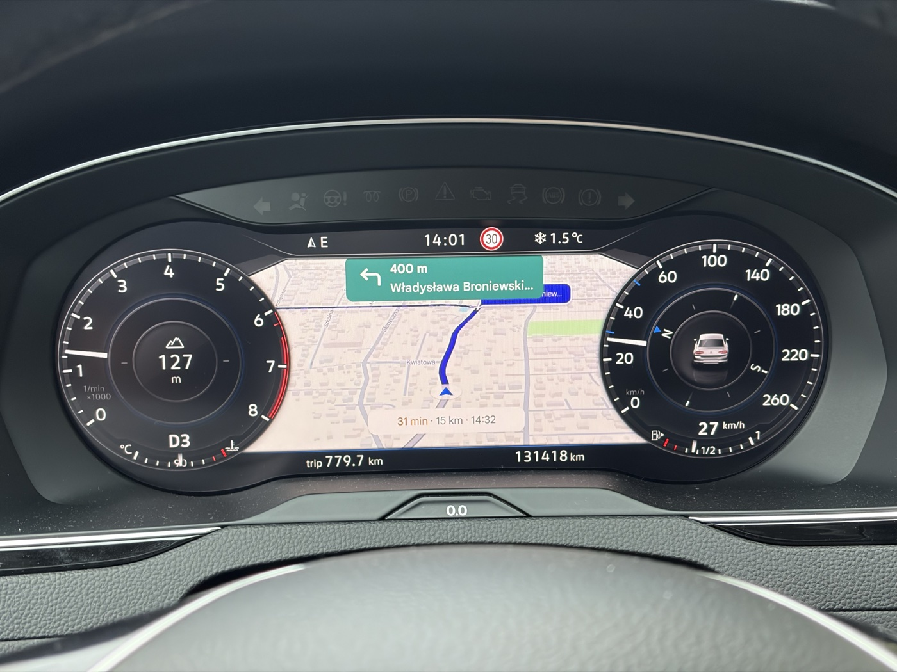
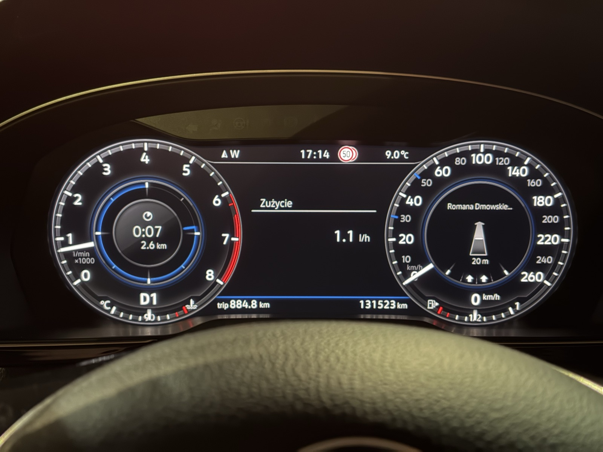
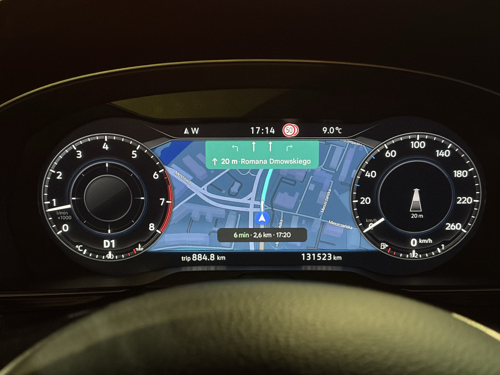
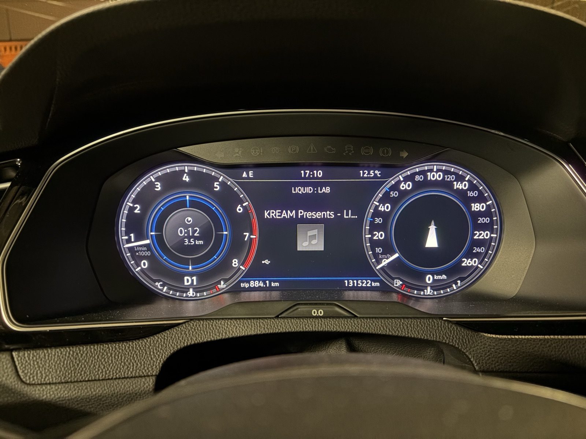

# mhi2-aid-carplay

CarPlay i Android Auto na AID: mapa z telefonu i natywne prowadzenie VW na wirtualnym kokpicie (AID) **VW Passata B8
(MY2018)** z radiem **Discover Pro MHI2**: **MU1161**, train `MHI2_ER_VWG13_P4512`, AID 791.

[English version: README.md](README.md)

> **Beta: Golf z USA, MU1418 (`MHI2_US_VWG13_P3662`), AID 791.** Pierwszy, jeszcze niesprawdzony w aucie build dla tej
> jednostki jest na gałęzi `beta`: jak testować w [BETA.md](BETA.md) (po angielsku), co robi w [BETA-CHANGELOG.md](BETA-CHANGELOG.md).


W repo jest tylko to, co dotyczy tego radia. Całość opiera się na pracy projektów wymienionych w sekcji
[Podziękowania](#podziękowania). Tam jest ogólne rozwiązanie mapy CarPlay na liczniku MHI2.

> **Uwaga.** To modyfikuje system multimedialny auta. Uruchomione w dokładnie jednym aucie: MU1161 + AID 791, firmware
> P4512. Każdy krok instalatora sprawdza hashe plików i zatrzymuje się przy każdej niezgodności, ale używasz na własne
> ryzyko. Nigdy nie wgrywaj firmware'u z innej gałęzi (cross-flash), żeby coś pasowało. Projekt niezwiązany z Volkswagenem,
> Harmanem ani Apple.

## Co działa (sprawdzone w aucie, październik i listopad 2026)

| Funkcja | Stan |
|---|---|
| Mapa CarPlay na AID (Mapy Apple, Google Maps), duże i małe zegary | działa |
| NavActiveIgnore: radio nie zatrzymuje i nie blokuje nawigacji z telefonu | działa |
| Natywne prowadzenie VW z iPhone'a: dystans i czas do celu na pasku VW i w lewej tarczy | działa |
| Natywna strzałka manewru i dystans do manewru (pojawia się po ruszeniu) | działa |
| Strzałka na starcie trasy i przy skrętach na rondzie (zastępcza tam, gdzie ścisłe mapowanie nie daje żadnej) | działa |
| Pasek odległości przed manewrem (odliczanie VW) i nazwa bieżącej ulicy | działa |
| Natywne pasy ruchu VW, także pasy do zawracania (gdy aplikacja w telefonie wysyła pasy) | działa |
| Przeliczanie trasy zachowuje dystans, pasek, ulicę i przyjazd z symbolem VW „wyznaczanie trasy”; Mapy Apple na telefonie po polsku nie gubią strzałek i pasów (tomasz-twardzicki MU1367 v1.4.5/v1.4.6) | nowe, jeszcze nie sprawdzone w aucie ([szczegóły](rg/README.pl.md#przeliczanie-trasy-strzałka-zastępcza-strona-zawracania-nazwy-map-apple-v161-mu1367-v145v146)) |
| Prowadzenie przetrwa zawieszony odczyt sterownika iAP2 (czytnik restartuje swój proces roboczy zamiast się kończyć) | w aucie od 2026-11-03; odzyskiwanie sprawdzone na komputerze |
| Przybliżanie mapy strzałkami na kierownicy | działa |
| Tytuł i wykonawca utworu na AID (CarPlay; Android Auto od v1.7.0) | działa |
| Przełączanie dzień/noc mapy na liczniku | działa |
| Ograniczenie prędkości z telefonu (`showSpeedLimit=yes`) | na tym radiu nic nie pokazuje |
| Android Auto 1.1 (od v1.7.0; 1.0 w v1.6.0, w v1.5.x otwarta alfa 0.1): obraz Google Maps na AID przez własny zapis MOST pmcp, strzałki VW z Google Maps; nazwa drogi, pasy i cel, gdy AID nie pokazuje mapy Android Auto | działa, z jednym znanym problemem: [Android Auto](#android-auto-na-aid-android-auto-11) |
| Strona ustawień w radiu (v1.5.1, paczka `ui`): App-Connect → Settings → AID navigation configuration; „Save: everything works” zatwierdza start próbny bez karty SD | nowe w v1.5.1, [opis po angielsku](ui/README.md) |
| Opcjonalnie (v1.4.1, paczka `sl`; przyciski trybu poprawione w v1.4.2 od amjad-alarori, od v1.5.1 tryb ustawiany na stronie ustawień): limit z map samego auta VW przed nazwą ulicy albo próbnie w CurrentPositionInfo | 50 → 70 km/h potwierdzone w e-Golfie (AID 795A); na AID 791 jeszcze nie sprawdzone. [Opis po angielsku](docs/en/16-native-speed-limits.md) |

Prowadzenie iAP2 nie przenosi liczbowego ograniczenia prędkości (badania
[maxim-smirnov/mhi2-carplay-cluster](https://github.com/maxim-smirnov/mhi2-carplay-cluster) na iOS 26.6/27);
`showSpeedLimit=yes` tylko prosi telefon o narysowanie znaku w obrazie, a na tym radiu znaku nie widać.


v1.4 w aucie (2026-11-04), Apple Maps z natywnym prowadzeniem VW: nazwa ulicy na górnym pasku i w prawym zegarze,
strzałka skrętu z paskiem VW odliczającym do manewru, czas i dystans do celu oraz pasy ruchu VW (drugie zdjęcie). Znak
ograniczenia prędkości u góry pochodzi z samego auta (rozpoznawanie znaków i dane nawigacji VW), nie z telefonu.

| | |
|---|---|
|  |  |

Więcej zdjęć i interaktywny model ramki AID (gdzie obraz trafia na panel w każdym wariancie):
[`docs/aid-frame-map.pl.html`](docs/aid-frame-map.pl.html), zdjęcia w [`docs/img/`](docs/img/).

## Składniki

| Katalog | Co buduje | Trafia do radia |
|---|---|---|
| [`patches/mu1161/`](patches/mu1161/) | warianty `core.so` strumienia CarPlay na licznik (safe area, URL, liczba klatek, klatki kluczowe, rozmiar fizyczny) z jednej przypiętej hashem bazy | `core.so` |
| [`navactiveignore/`](navactiveignore/README.pl.md) | NavActiveIgnore z własnych klas HMI radia | Java (HMI) |
| [`rg/`](rg/README.pl.md) | natywne prowadzenie (jedna paczka `rg`): port rozwiązania tomasz-twardzicki z MU1427 na MU1161 (iAP2 RouteGuidance → BAP) z jego pasami, paskiem odległości i nazwą ulicy, nasze pasy do zawracania i zastępcze strzałki, nasza bramka logu iAP2 i czytnik | Java, sterownik iAP2, `iap2.cfg`, czytnik |
| [`nowplaying/`](nowplaying/README.pl.md) | tytuł i wykonawca utworu CarPlay na liczniku | Java (HMI) |
| [`hmiextras/`](hmiextras/README.pl.md) | zoom z kierownicy i ponowne wysłanie dzień/noc do mapy na liczniku | Java (HMI) |
| [`aa/`](aa/) | Android Auto na AID: wrapper `gal`, hook MacsInSpace (przypięty, bez ścieżek do karty SD), nasz feeder MOST | wrapper `gal`, pliki w `carplaymaps/aa/` |
| [`speedlimit/`](speedlimit/) | opcjonalny limit prędkości z map VW w tekście nawigacji licznika | Java (HMI), zapisywane ustawienie. [Opis po angielsku](docs/en/16-native-speed-limits.md) |
| [`ui/`](ui/) | strona ustawień w fabrycznych ustawieniach App-Connect: zapis startu próbnego, tryb limitu prędkości | Java (HMI) |
| [`installer/`](installer/) | instalator na kartę SD uruchamiany z menu GEM w M.I.B., karta ratunkowa, testy na Macu | nic sam z siebie |
| [`buildtools/`](buildtools/) | kontrole przy budowaniu: osłona try/catch każdego wywołania haka, zgodność z API J9 CDC | nic |
| [`scripts/`](scripts/) | czytniki obrazów firmware'u tylko do odczytu (QNX6, IFS, LZOZ, JXE → JAR), tester kart SD | nic |
| [`firmware/`](firmware/) | hashe i notatki oficjalnej aktualizacji K4525 (jedyny dozwolony firmware) | nic |

### Strona ustawień w radiu (`ui`)

App-Connect → Settings → **AID navigation configuration** (instaluje ją przycisk 4). Dwa wiersze:
- **Changes**: „Save: everything works” zatwierdza start próbny tak jak GEM „5. Confirm”, bez karty SD.
- **Speed limit**: Off / Before street name / Street name (trial), działa w ciągu sekundy (wymaga `sl`; „Before street
  name” także `rg`).

Szczegóły i ograniczenia: [ui/README.md](ui/README.md).

### Warianty układu mapy (GEM → `pmcp_advanced` → `carplay_advanced`)

Strumień ma 800×480 i leży 1:1 na panelu AID. Safe area: x / y / szerokość / wysokość.

| Wariant | URL | Safe area | Uwagi |
|---|---|---|---|
| `map-clean` | `maps:/car/instrumentcluster/map` | 200 / 108 / 400 / 296 | sama mapa, prowadzenie pokazuje VW natywnie |
| `card-clean` | `maps:/car/instrumentcluster` | 200 / 108 / 400 / 296 | z kartą manewru iPhone'a |
| `url-map-hybrid` | `…/map?showSpeedLimit=yes` | 200 / 108 / 400 / 296 | parametr ograniczenia prędkości (bez efektu) |
| `map-clean-l40` | `maps:/car/instrumentcluster/map` | 160 / 108 / 400 / 296 | 40 kolumn w lewo |
| `map-square` | `maps:/car/instrumentcluster/map` | 240 / 60 / 320 / 340 | układ mathsls dla MU1161, bliżej kwadratu; najlepszy po dłuższej jeździe; 30 kl./s |
| `map-square-fps40` (domyślny) | `maps:/car/instrumentcluster/map` | 240 / 60 / 320 / 340 | `map-square` przy 40 kl./s (jak u mathsls); w jeździe testowej bez większego opóźnienia niż 30 kl./s |

Wszystkie warianty deklarują rozmiar fizyczny 240×144 mm. Zmiana wariantu podmienia jeden plik (`core.so`) i wymaga restartu.

## Pobieranie i instalacja

**[Pobierz najnowsze wydanie](https://github.com/chrzanowy/mhi2-aid-carplay/releases/latest)**: plik
`mhi2-aid-carplay-cards-<build id>.zip` z gotowymi obiema kartami SD. Nic nie trzeba instalować, Windows albo Mac.

1. Rozpakuj zip i otwórz `README-FIRST.txt` (po angielsku, krok po kroku).
2. Dwuklik na `Copy-to-SD-Windows.bat` (Windows) albo `Copy-to-SD-macOS.command` (Mac): kopiuje kartę na **pustą**
   kartę SD FAT32, sprawdza każdy plik i wysuwa kartę. Niczego nie formatuje ani nie usuwa. Zrób kartę 1
   (instalacyjną) i kartę 2 (ratunkową, na awarię).
3. W aucie, jedna wizyta, tylko karta 1 (część 2 w `README-FIRST.txt`, szczegóły: [tutorial w aucie](docs/pl/09-tutorial-w-aucie.md)):
   **1. Check → 2. Install CarPlay → restart → mapa OK? → 4. Install additional features → restart (start próbny) →
   test → 5. Confirm → restart.** Od tej chwili tak już zostaje. (Android Auto, opcjonalnie: 3. Install Android Auto,
   niżej.)
   Karta 2 jest tylko na awarię po potwierdzeniu. Po użyciu sama się rozbraja; opcja 3 pomocnika kopiowania ją uzbraja.

**Aktualizacja z v1.5.0, v1.4.x albo v1.0–v1.3:** karta 1 z tego wydania, „1. Check”, potem **2. Install CarPlay**
(zwykle „already installed”), **3. Install Android Auto**, jeśli używasz Android Auto, **4. Install additional
features**. Jeśli 3 albo 4 coś zainstalowały: restart (start próbny) → test → **5. Confirm** w tym starcie (albo „Save: everything works” na stronie ustawień).
Z v1.5.0 przycisk 4 dodaje stronę ustawień, więc restart i 5 są potrzebne. Jeśli wszystkie odpowiadają
„already installed” / „nothing changed” (karta z tymi samymi funkcjami), nic się nie zmieniło: bez restartu i bez 5. Przycisk 4 zastępuje wcześniejszy sterownik,
czytnik i paczki Java (`rglu`, `rg`, eksperymentalne `rg-aa` → `rg` z tej karty) plikami z tej karty. Przycisk 3
aktualizuje na miejscu znane mu Android Auto z wcześniejszej karty eksperymentalnej, a Android Auto, którego nie
obsługuje, zastępuje zestawem z tej karty. Przy przejściu z v1.0–v1.3 zrób też nową kartę 2: karty ratunkowe sprzed
v1.4 nie przywracają sterownika iAP2 z v1.4.
**Z v1.6.0:** 2 („already installed”), 3, jeśli używasz Android Auto (Android Auto 1.1 na miejscu, wybrane wyjście zostaje),
4 (prowadzenie i tytuły utworów na miejscu, `sl`, `ui` i tryb ograniczeń prędkości zostają); potem restart, telefon
i 5 (albo „Save” na stronie ustawień) w tym starcie.
**Z v1.5.1:** 2 („already installed”), 3, jeśli używasz Android Auto (przenosi na miejscu Android Auto na 1.1, także
z feederów v11–v13 kart eksperymentalnych), 4 (strona ustawień z nowym wierszem „Android Auto output”); potem restart,
telefon i 5 (albo „Save” na stronie ustawień) w tym starcie.

Wcześniej potrzebny jest [M.I.B. w radiu i backup](docs/pl/01-mib-instalacja-backup.md). Instalator na karcie najpierw
sprawdza każdy plik radia; przy innym firmware zatrzymuje się i niczego nie zmienia.

Samodzielne zbudowanie kart z własnego backupu (zaawansowane, macOS): `./install.sh`, szczegóły w
[README.md](README.md#build-the-cards-yourself-advanced).

## Instalator

Instalator uruchamia się z menu GEM (inżynierskiego) w [M.I.B.](https://github.com/Mr-MIBonk/M.I.B._More-Incredible-Bash)
z karty SD. Zasady:

- **Fail-closed.** Każdy plik w radiu i na karcie jest sprawdzany dokładnym hashem i rozmiarem, zanim cokolwiek zostanie
  zapisane. Nieznany stan oznacza brak zmian.
- Pliki są kopiowane do katalogu przejściowego, sprawdzane i dopiero wtedy podmieniane. Wcześniej powstaje kopia plików
  fabrycznych. „8. Remove everything (back to factory files)” działa zawsze.
- **Paczki Java mają start próbny.** Po „4. Install additional features” (albo „On ...” dla jednej paczki) i restarcie
  zmianę trzeba potwierdzić („5. Confirm”) w tym samym starcie.
  Inaczej następny start jest znowu fabryczny.
- Osobna **karta ratunkowa** (`installer/build_rescue.py`) startuje sama w trybie aktualizacji i przywraca fabryczne HMI
  bez potrzeby wchodzenia do GEM.
- Testy na Macu (`installer/test/run_tests.sh`, `fault_inject.sh`) uruchamiają instalator na kopii drzewa plików radia,
  w powłokach `mksh` i `ksh`. Symulują też zanik zasilania na każdym kroku zapisu.

Instrukcja krok po kroku w aucie: [`docs/pl/09-tutorial-w-aucie.md`](docs/pl/09-tutorial-w-aucie.md).
Projekt instalatora: [`docs/pl/07-instalator.md`](docs/pl/07-instalator.md).

## Budowanie

Repo (źródła) **nie zawiera binarek** ani niczego z firmware'u Volkswagena. Każdy build czyta wejścia z katalogu roboczego obok
repo i sprawdza każde wejście hashem SHA-256:

```
workspace/
  mhi2-aid-carplay/        to repo
  upstream/                klony projektów niżej, na przypiętych commitach
  backup/MU1161/           backup M.I.B. Twojego radia (albo zmienna PMCP_BACKUP)
  archives/                menu GEM z M.I.B. 3.6.0, przekonwertowany lsd.jar Twojego radia
```

| Wejście | Źródło | Przypięte |
|---|---|---|
| bazowy `core.so` (profil MU1102/791, sha256 `00b48a8f…`) | paczka omonob w M.I.B. | commit `3a2526a3` |
| natywne prowadzenie, miejsca łatek | tomasz-twardzicki/MHI2-Carplay-Maps | commit `024dd159` (MU1427), `7925a83` (pasy), `1d69473` (pasek odległości, ulica, odzyskiwanie), tagi `MU1367-v1.4.5`/`MU1367-v1.4.6` (przeliczanie trasy, strona zawracania, nazwy Map Apple) |
| tablica manewrów dla zastępczych strzałek | harman-f/mhi2_altscreen_carplay (`MibrRgiManeuvers.java`) | commit `c01bbdc` |
| paczka referencyjna MU1161/791 | mathsls/MHI2-Carplay-Maps | commit `cdd576b0` |
| konwerter JXE → JAR | luka-dev/jxe2jar | commit `9eeb45bb` |
| menu GEM (`Launcher-sda0.esd`) | zip M.I.B. 3.6.0 | sha256 `4bfc6e72…` |
| klasy HMI, sterownik iAP2 | Twoje radio (backup M.I.B.) | sha256 każdego pliku |
| narzędzia | ASM 9.7 (buildy Java), pyelftools 0.31 w `upstream/tools/venv-elftools` (`rg/`), gawk 3.1.5 w `upstream/tools/` (testy) | jary ASM po sha256 |

Kolejność: `navactiveignore/`, `nowplaying/`, `hmiextras/`, `rg/` (w każdym `build.sh`; potrzebny JDK 11+ i ASM 9.7
w `$ASM_DIR`), potem `patches/mu1161/build_core.py`, `installer/build_sd.py`, `installer/build_card_install.py`
i `installer/build_rescue.py`. Pythona uruchamiaj z `python3 -I`. Gdy którekolwiek wejście ma inny hash, build się zatrzymuje.

## Dokumentacja

Po polsku w [`docs/pl/`](docs/pl/), po angielsku w [`docs/en/`](docs/en/):

| Temat | Polski | English |
|---|---|---|
| Instalacja M.I.B. i backup radia (zrób najpierw) | [01-mib-instalacja-backup](docs/pl/01-mib-instalacja-backup.md) | [01-mib-install-backup](docs/en/01-mib-install-backup.md) |
| Analiza HMI: strumień mapy, wykrywanie rozmiaru AID, klasy CarPlay i prowadzenia | [04-lsd-jxe-dekompilacja](docs/pl/04-lsd-jxe-dekompilacja.md) | [04-lsd-jxe-decompilation](docs/en/04-lsd-jxe-decompilation.md) |
| Projekt instalatora | [07-instalator](docs/pl/07-instalator.md) | [07-installer](docs/en/07-installer.md) |
| Audyt: szybki start mapy na AID (próby, porażka, dlaczego AID wymagał uśpienia auta) | [14-audyt-szybki-start](docs/pl/14-audyt-szybki-start.md) | [14-fast-start-audit](docs/en/14-fast-start-audit.md) |
| Instrukcja krok po kroku w aucie | [09-tutorial-w-aucie](docs/pl/09-tutorial-w-aucie.md) | [09-in-car-guide](docs/en/09-in-car-guide.md) |
| Android Auto w aucie: instalacja, potwierdzenie, co sfotografować, usuwanie | [13-instrukcja-android-auto](docs/pl/13-instrukcja-android-auto.md) | [13-android-auto-guide](docs/en/13-android-auto-guide.md) |
| Interaktywny model ramki AID | [aid-frame-map.pl.html](docs/aid-frame-map.pl.html) | [aid-frame-map.html](docs/aid-frame-map.html) |

Katalogi składników mają `README.md` po angielsku i `README.pl.md` po polsku.

## Android Auto na AID (Android Auto 1.1)

Ta sama karta daje też Android Auto na AID: obraz Google Maps z telefonu z Androidem, przez własną drogę MOST radia (bez
dodatkowego adaptera), oraz natywne strzałki VW z Google Maps. Android Auto 1.0 (v1.6.0) było pierwszą wersją stabilną:
pmcp sam zapisuje obraz na AID (direct); w v1.5.x była otwarta alfa 0.1 przez bridge CarPlay. Android Auto 1.1 (v1.7.0)
dodaje resztę prowadzenia VW i tytuł utworu.



*Android Auto w aucie (2026-11): obraz Google Maps z telefonu z Androidem na AID.*

Co działa (sprawdzone w aucie, Samsung Galaxy A16 z Androidem 16):
- obraz Google Maps na AID, także po przełączeniu z CarPlay na Android Auto bez restartu;
- strzałki VW z dystansem z manewrów Google Maps, pokazywane przez ten sam pakiet prowadzenia `rg` co dla CarPlay;
- od 1.1: nazwa drogi, pasy ruchu, dystans i czas do celu z Google Maps, jak przy CarPlay, ale tylko wtedy, gdy AID nie
  pokazuje mapy Android Auto. Google Maps rysuje je we własnym obrazie, więc przy mapie na AID nasze są ukryte; w
  pozostałych widokach AID (komputer pokładowy, zużycie, media) są obok strzałki VW. Zmiana widoku przełącza je w ćwierć
  sekundy;
- od 1.1: tytuł utworu, wykonawca i album z telefonu na AID (pakiet `np`, jak przy CarPlay);
- przez kilka jazd żadna klatka nie zginęła i nie było błędu MOST; obraz idzie za telefonem z ok. 0,1 s zapasu dekodera.

|  |  |
|---|---|
| *Android Auto 1.1, AID bez mapy: strzałka VW, nazwa drogi, pasy, czas i dystans do celu.* | *Kilka sekund później z mapą Android Auto na AID: zostaje tylko strzałka VW i jej dystans.* |



*Utwór z Android Auto na AID (1.1), czas i dystans do celu w lewym zegarze.*

Wyjście: „AA output: pmcp MOST writer (default, from the next connection)” albo „AA output: CarPlay bridge (fallback,
from the next connection)” w `aa_advanced` (także na stronie ustawień). Działa od następnego podłączenia telefonu, bez
restartu i bez 5.

Znany problem i ograniczenia:
- po wyjściu z Android Auto na ekranie głównym i powrocie telefon może zwolnić obraz na AID, a rzadko go zatrzymać (AID
  pokazuje ekran ładowania): podłącz telefon ponownie;
- strumień rusza około 5 s po podłączeniu telefonu;
- brak strzałki VW na pierwszym kroku trasy;
- nazwa drogi to to, co Google Maps wysyła jako drogę: na niektórych krokach jest to kierunek („w kierunku: …”) albo
  sama instrukcja, w języku telefonu. Pokazujemy ją tak, jak przychodzi;
- czas do celu jest zaokrąglany w górę do pełnej minuty (jak przy CarPlay), więc bywa o minutę dłuższy niż w Google Maps.

Instalacja (potrzebna mapa CarPlay z „2.”; dla strzałek także „4. Install additional features”):
1. GEM → `pmcp_stream_map_aid` → **„3. Install Android Auto: Google Maps on the AID + VW arrows (needs 2)”**. Aktualizuje
   na miejscu Android Auto z v1.5.x i z wcześniejszych kart eksperymentalnych i zastępuje pliki Android Auto, których ta
   karta nie obsługuje.
2. Restart, telefon z Androidem na kablu, trasa w Google Maps. Ta pierwsza sesja to próba.
3. Jeśli obraz jest na AID: „5. Confirm: everything works (in the first start after 3 or 4)” w tym samym starcie,
   z podłączonym telefonem (jednocześnie potwierdza próbę funkcji CarPlay, jeśli trwa).

Usuwanie: `pmcp_advanced` → `aa_advanced` → „AA remove (factory Android Auto back)” albo „8. Remove everything (back to
factory files)” na ekranie głównym. Oba przywracają fabryczny odbiornik Android Auto (`gal`), tylko z kopii o fabrycznym
hashu. Przycisk 4 ani nie instaluje, ani nie usuwa Android Auto.

Krok po kroku i co sfotografować, gdy coś nie działa: [docs/pl/13-instrukcja-android-auto.md](docs/pl/13-instrukcja-android-auto.md).
Jak to działa (hook `gal` od MacsInSpace, nasz feeder, start próbny): [aa/README.pl.md](aa/README.pl.md).

## Podziękowania

Ten projekt nie powstałby bez:

- **[omonob/MHI2-Carplay-Maps](https://github.com/omonob/MHI2-Carplay-Maps)**: pierwotne rozwiązanie mapy CarPlay na
  wirtualnym kokpicie MHI2. Jego `core.so` (profil MU1102/791) jest bazą, którą łata każdy wariant tutaj.
- **[Mr-MIBonk/M.I.B.](https://github.com/Mr-MIBonk/M.I.B._More-Incredible-Bash)**: narzędzia GEM, z których startuje
  instalator, backup radia i dystrybucja paczki omonob.
- **[tomasz-twardzicki/MHI2-Carplay-Maps](https://github.com/tomasz-twardzicki/MHI2-Carplay-Maps)**: miejsca łatek
  `core.so` (liczba klatek, klatki kluczowe, URL, safe area), klasy NavActiveIgnore i rozwiązanie natywnego prowadzenia
  (łańcuch łatek sterownika, most HMI, czytnik RGI), które `rg/` przenosi na MU1161: MU1427 v1.2.0 (strzałki, dystans,
  ETA, ścisłe mapowanie manewrów `LiveModel.map`), pasy ruchu z MU1367 v1.4.0 oraz pasek odległości, nazwa ulicy
  i odzyskiwanie strumienia z MU1367 v1.4.3 oraz podtrzymanie trasy Apple Maps z MU1367 v1.4.4 (nasze v1.4.3),
  a także przeliczanie trasy, strzałkę zastępczą, stronę zawracania i nazwy Map Apple z MU1367 v1.4.5/v1.4.6 (nasze v1.7.0).
- **[mathsls/MHI2-Carplay-Maps](https://github.com/mathsls/MHI2-Carplay-Maps)**: pierwszy build dla MU1161 + AID 791.
  Z niego pochodzą miejsca rozmiaru fizycznego i układ wariantu `map-square`.
- **[ZzYunOvO/MHI2-Carplay-Maps](https://github.com/ZzYunOvO/MHI2-Carplay-Maps)**: zestaw narzędzi, na którym opierają
  się forki mathsls i tomasz-twardzicki.
- **diasdio** i **ramasauskas**: poprawki klatek kluczowych i wysokości safe area, poprawka kolejki AUSAFE w moście MOST.
- **harman-f**: parametry URL licznika (`showETA`, `maneuverLayout`, `showSpeedLimit`) oraz tablica manewrów iAP2 → VW BAP
  z [mhi2_altscreen_carplay](https://github.com/harman-f/mhi2_altscreen_carplay) (`MibrRgiManeuvers.java`, commit
  `c01bbdc`, GPL-3.0), z której korzystają zastępcze strzałki w `rg/`.
- **[luka-dev](https://github.com/luka-dev/jxe2jar)**: jxe2jar, dekoder RGI i nazwy typów manewrów iAP2.
- **[amjad-alarori](https://github.com/amjad-alarori)**: opcjonalna paczka limitu prędkości z map VW `speedlimit/` (PR #3):
  hak `DSITrafficRegulation`, filtr limitu oraz jego akcje instalatora i testy; poprawka przycisków trybu w radiu
  (PR #5, v1.4.2).
- **maxim-smirnov**: opis formatu kontenera LZOZ oraz badania pokazujące, że prowadzenie iAP2 nie przenosi ograniczenia
  prędkości ([mhi2-carplay-cluster](https://github.com/maxim-smirnov/mhi2-carplay-cluster)).
- **[MacsInSpace/mib-cluster-map](https://github.com/MacsInSpace/mib-cluster-map)**: hook `gal`, na którym opiera się
  Android Auto na AID (commit `07361db`, budowany w `aa/hook/` bez ścieżek do karty SD): drugi ekran „cluster”
  zgłaszany telefonowi i przekazanie jego strumienia H.264.
- **MacsInSpace**: wskazówka „Zapomnij to auto”, gdy licznik nie dostaje obrazu.
- Społeczność **MQB Toolbox**: pierwotny pomysł NavActiveIgnore.

Pliki, które adaptują kod z tych projektów, podają źródło i commit w nagłówku albo w README.

## Licencja

GPL-3.0-or-later, zobacz [LICENSE](LICENSE). To ta sama licencja co w projektach omonob, tomasz-twardzicki i mathsls,
na których to się opiera.
